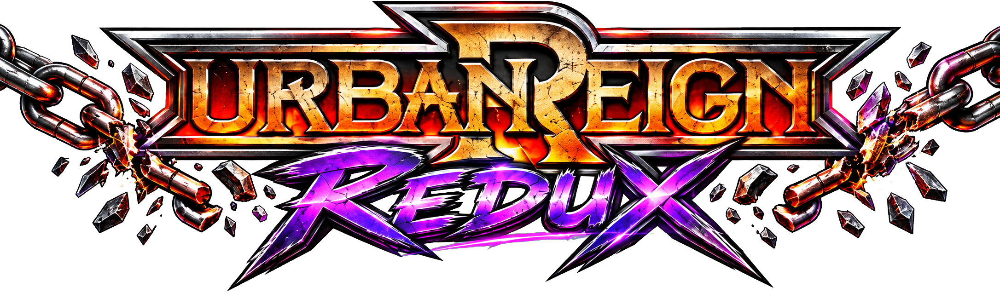

# Urban Reign Redux 0.5

More fighters, revised movesets, new voices, music and menus for Urban Reign. A community project by **Jasonafex**.

## Download

**[Download 0.5 — all-in-one package, 2.67 GB](https://drive.google.com/file/d/1anZDvW-zTK52fi4HEZLxqO-3OlE2e1Wl/view)**

**[Mod Manager + Editor 0.5 — GitHub release](https://github.com/Jasonafex/urban-reign-redux/releases/tag/v0.5.0)** — build the tested release from your own Urban Reign (USA) ISO and choose your packs.

[Full patch notes and checksums](https://github.com/Jasonafex/urban-reign-redux/releases/tag/v0.5.0) · [Project website](https://jasonafex.github.io/urban-reign-redux/) · [Report an issue](https://github.com/Jasonafex/urban-reign-redux/issues)

Released October 28, 2026. The Google Drive download is available to anyone with the link; no sign-in is required.

The all-in-one ZIP includes the ready-made 0.5 disc, HD textures in PCSX2's folder layout, the Extra Memory game setting, START HERE.txt, patch notes and checksums. Supply your own PCSX2 installation and PS2 BIOS.

The portable Mod Manager includes the base pack and both HD texture sets. Unzip it, open **Urban Reign Redux Launcher.exe**, select your own Urban Reign (USA) ISO and PCSX2 folder, choose the packs and press **Build modded disc**. With no extra fighter packs, the checked result is byte-identical to the tested 0.5 release (PCSX2 CRC **74E78599**). The launcher also installs the HD textures and Extra Memory setting.

The optional portable Editor starts with **Urban Reign Redux Editor.exe**. The earlier Auto-Installer is a separate legacy release.

## All-in-one setup

1. Extract the ZIP, read **START HERE.txt**, and put the new ISO in your games folder.
2. With PCSX2 closed, follow the included instructions to install the matching textures and Extra Memory game setting. Back up older Redux texture packs outside the active texture folder to avoid conflicts. Enable **Load Textures**.
3. **Start from a fresh boot, not an older emulator save state.** Memory-card saves are fine.

## What's new in 0.5

- Updated fighters, Fighter Files stats, styles and bios; Ricardo gets his own select slot, name and Fighter Files page.
- Grounded idles, skeleton repairs and Tekken 8 stances; long strings connect more reliably.
- Yoshimitsu's voice, sound and move fixes, including the Player 2 selection freeze repair.
- Jeff's Twist of Fate, idle, taunt and side SPA fixes; Snake's up SPA now does damage.
- Cleaner hair, glasses and clothing, reduced rainbow sheen, spring repairs and two HD texture packs.

See the [complete release notes and known issues](https://github.com/Jasonafex/urban-reign-redux/releases/tag/v0.5.0) for character-specific changes.

## About

[Explore the project and screenshots](https://jasonafex.github.io/urban-reign-redux/) · [Release history](CHANGELOG.md)

This repository hosts the release, website and setup support. It does not include the editor's complete source. No blanket license is granted to third-party game or character assets. Not affiliated with or endorsed by the original game's publisher.
